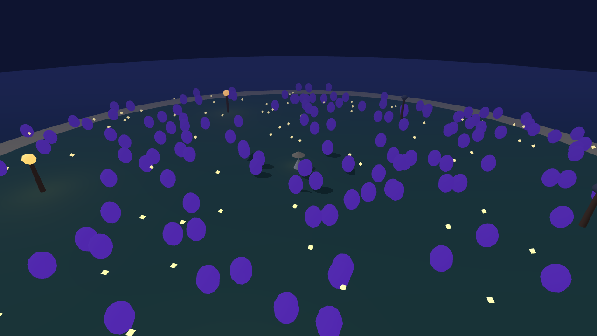

# Đảo Đèn Lồng — Game 3D & Headless Engine (`v1.0.0` · Contract v1.3)

> **Video Demo (< 5 phút):** [Xem / Tải Video Demo (.mp4, < 5 phút)](https://github.com/Dobit25/K5-L3A-DAY12-TruongHoangTung-2A202603651-AI-SDLC-Dao-Den-Long/releases/download/v1.0.0/demo.mp4) · [Trang Release v1.0.0](https://github.com/Dobit25/K5-L3A-DAY12-TruongHoangTung-2A202603651-AI-SDLC-Dao-Den-Long/releases/tag/v1.0.0)



## Giới thiệu
**Đảo Đèn Lồng** là game 3D góc nhìn thứ ba qua **3 Đêm (Đảo Bến · Đảo Cau · Đảo Chuông)**: người chơi điều khiển **Mây** (đội nón lá treo đèn lồng nhỏ) gom **Đom Đóm**, thắp và châm dầu giữ tối thiểu **60% Đèn Lồng Lớn** cháy sáng tới bình minh (`3/5`, `4/6`, `5/7`), đẩy lùi **Bóng Mực** (có cơ chế hút dầu `drain`) và **Gió Lạc**, tận dụng **Lướt (Dash)**, **Bục nhảy**, **Bùa Gió**, **Tỏa Sáng (Pulse)**, **Bảng xếp hạng cục bộ**, và bộ tính năng **Dễ tiếp cận (Accessibility)** đầy đủ.

- **Tác giả:** TruongHoangTung — MSSV: `2A202603651` — Lớp: `K5-L3A`
- **Giấy phép:** [MIT](LICENSE) | **Ghi nguồn:** [CREDITS.md](CREDITS.md) | **Lịch sử thay đổi:** [CHANGELOG.md](CHANGELOG.md)

---

## Yêu cầu hệ thống
- **Runtime:** Node.js `>= 18` (đã kiểm thử trên Windows 11, macOS và Linux qua GitHub Actions) + trình duyệt hỗ trợ WebGL2 (Chrome / Edge / Safari / Firefox).
- **Tùy chọn Docker:** Hỗ trợ đóng gói bằng [Dockerfile](Dockerfile) (`docker build -t dao-den-long . && docker run -p 4173:4173 dao-den-long`).

---

## Cài đặt & Chạy nhanh (tối đa 3 lệnh từ bản clone sạch)
```bash
npm ci
npm run build
npm start
```
Mở trình duyệt tại `http://localhost:4173`. *(Lệnh `npm start` chạy `node scripts/run-game.mjs`, phục vụ bản web tĩnh `dist/` kèm API bảng xếp hạng lưu trực tiếp xuống đĩa cục bộ `data/leaderboard.json`).*

---

## Điều khiển (mặc định — đổi phím tự do trong Cài đặt)
| Phím mặc định | Hành động |
|---|---|
| `W / A / S / D` | Di chuyển theo hướng camera (`6.0 m/s`, `7.2 m/s` khi có Bùa Gió) |
| `Space` | Nhảy (`7.0 m/s`, chỉ nhảy khi chạm đất) |
| `ShiftLeft` | Lướt / Dash (`14 m/s`, `0.2s`, giữ độ cao khi lướt trên không, hồi `1.5s`, `0s` khi có Bùa Gió) |
| `E` (hoặc `Enter`) | Tương tác đèn (`<= 2.0m`): thắp mới (`10`), thắp lại (`5`), hoặc châm dầu đèn sáng (`+10` dầu/đom đóm) |
| `Q` | Tỏa Sáng / Pulse (tốn `3` đom đóm, bán kính 3D `5m` từ chân `+0.8m`, choáng `120t`, đẩy `4m`, hồi `3s`) |
| `P` hoặc `Esc` | Tạm dừng / Mở cài đặt (âm lượng, độ nhạy chuột, chế độ mù màu, giảm chuyển động, chữ lớn `×1.25`, đổi phím) |
| Kéo chuột trái hoặc `← / →` | Xoay camera (`cam_yaw_deg`) |
| `M` | Bật / tắt âm thanh tổng hợp |

---

## Kiểm chứng, Headless, Benchmark, Soak & Bảng xếp hạng (Contract v1.3)

| Mục đích | Lệnh chạy |
|---|---|
| **Cổng kiểm chứng toàn diện (1 lệnh)** | `npm run verify` |
| **Chế độ Headless (`--night 1\|2\|3`)** | `node dist-cli/cli/headless.js --seed 2026 --night 3 --ticks 18000 --snapshot-every 600 --out out.jsonl` |
| **Benchmark 30s 1280×720** | `node scripts/bench.mjs --seed 42 --duration 30 --out bench.json` |
| **Soak test 10 Đêm liên tiếp** | `node --expose-gc dist-cli/cli/soak.js --seed 7 --nights 10 --out soak.json` |
| **Xuất Bảng xếp hạng cục bộ** | `node scripts/run-game.mjs --export-leaderboard out.json` |

- **Ghi chú VSync & Bộ nhớ bản Web (`bench.json`):** `scripts/bench.mjs` khởi chạy Chromium/Chrome/Edge ở cửa sổ `1280×720` không toàn màn hình với cờ `--disable-frame-rate-limit --disable-gpu-vsync` (`vsync_off: true`). `peak_mem_mb` lấy từ `performance.memory.usedJSHeapSize` khi trình duyệt hỗ trợ (hoặc `null` nếu trình duyệt ẩn thông số bộ nhớ).

---

## Sáng tạo của tôi
Toàn bộ phần sáng tạo nằm hoàn toàn trong lớp hiển thị `src/render/` — **tách biệt tuyệt đối khỏi `src/core/` và bị tắt hoàn toàn trong cảnh benchmark & chế độ headless**:
1. **Không khí Ba Hòn Đảo cổ tích & Trải nghiệm tiếp cận toàn diện:** Mây đội nón lá treo đèn lồng mini tỏa sáng dần theo `carried / capacity`; biển mây trôi, bầu trời sao, bến gỗ Đảo Bến, cầu tre Đảo Cau, tháp chuông + lá bay Đảo Chuông; thanh dầu 3D + nhấp nháy `1 Hz` khi đèn yếu; đèn tắt xẹp 20% + vết rách; chế độ mù màu (`#00B3FF` + `#FFFFFF ⚠`), phụ đề sự kiện + mũi tên chỉ hướng Bóng Mực mới sinh, giảm chuyển động và chữ lớn `×1.25`.
2. **Âm thanh tổng hợp thời gian thực (Web Audio API):** Nhạc nền gió đêm êm nhẹ và đầy đủ SFX cho mọi hành động/sự kiện (ngũ cung nhặt đom đóm, nhảy, lướt, Bùa Gió, nạp/thắp đèn, Pulse, bị đánh, Bóng Mực xuất hiện, Gió Lạc, gió mạnh, đếm ngược 10s cuối, thắng/thua — 0 file audio ngoài).
- **Bằng chứng không ảnh hưởng lõi & số đo:** `npm run verify` (`33/33` tests PASS + SHA-256 determinism cả 3 Đêm), [bench.json](bench.json) (tắt toàn bộ thực thể sáng tạo) và [soak.json](soak.json) (`0` crash, RSS `54.0 → 57.4 MB`).

---

## Tài liệu & Bằng chứng SDLC (4 Phase)
- Contract: [game.contract.json](game.contract.json) (`v1.3`)
- Harness AI: [AGENTS.md](AGENTS.md), [.agents/skills/verify-phase/SKILL.md](.agents/skills/verify-phase/SKILL.md), [.github/workflows/ci.yml](.github/workflows/ci.yml)
- Ghi chép & Retro: [docs/notes/assumptions.md](docs/notes/assumptions.md), [docs/notes/adr-001-lantern-fuel-and-dawn-survival.md](docs/notes/adr-001-lantern-fuel-and-dawn-survival.md), [docs/notes/ai-log.md](docs/notes/ai-log.md), [docs/notes/retro.md](docs/notes/retro.md)
- Bằng chứng từng phase: `docs/proof/phase-1/`, `docs/proof/phase-2/`, `docs/proof/phase-3/`, `docs/proof/phase-4/`, [bench.json](bench.json), [soak.json](soak.json)

---

<details>
<summary>Tài liệu đề bài gốc — Day 12 AI SDLC: Đảo Đèn Lồng (lưu trữ nguyên văn)</summary>

# Day 12 — AI SDLC: Đảo Đèn Lồng

> **Cá nhân** (1 người / 1 MSSV) · Áp dụng SDLC cùng AI để xây một **game 3D** qua **4 phase**, từ yêu cầu ban đầu tới bản phát hành.
> **Lab board + trợ giảng:** **[Đảo Đèn Lồng Lab](https://claude.ai/artifact/Q1RYyv1dxjUczzCbd2ZnoW)**

---

## Tài liệu của lab

| File | Nội dung |
|---|---|
| [GUIDE.md](GUIDE.md) | Hướng dẫn làm lab: vòng làm việc mỗi phase, harness, kiểm chứng, token |
| [CHECKPOINTS.md](CHECKPOINTS.md) | Các mốc tự kiểm tra từ chuẩn bị đến nộp bài |
| [SUBMISSION.md](SUBMISSION.md) | Đặt tên repo, hạn nộp, tag, Release, video, checklist |
| [RULES.md](RULES.md) | Quy định: AI, trung thực về bằng chứng, bản quyền, bảo mật |
| [RUBRIC.md](RUBRIC.md) | Thang điểm chi tiết |

## Lab board

Yêu cầu dự án được phát hành tại **[Đảo Đèn Lồng Lab](https://claude.ai/artifact/Q1RYyv1dxjUczzCbd2ZnoW)**. Mỗi phase là một tab (tab chưa phát hành bị khóa), mỗi tab có trợ giảng AI riêng chỉ trả lời trong phạm vi phase đó. Trợ giảng cần đăng nhập claude.ai và dùng lượt Claude của bạn.

## Dự án

**Đảo Đèn Lồng**: game 3D góc nhìn thứ ba. Mây, người giữ đèn nhỏ tuổi, gom đom đóm để thắp lại các Đèn Lồng Lớn và né Bóng Mực trong sương đen.

- Không ràng buộc công nghệ; chạy được trên macOS hoặc Linux.
- Tuân theo **Test Contract** (chế độ headless) để được chấm tự động và so sánh với nhau.

| Phase | Bạn nhận | Nộp |
|---|---|---|
| 1 | **PRD-0** (mô tả tổng quát) + Test Contract | tag `phase-1` |
| 2 | **Ticket-02**, phát hành khi Phase 1 kết thúc | tag `phase-2` |
| 3 | **Ticket-03**, phát hành khi Phase 2 kết thúc | tag `phase-3` |
| 4 | **Ticket-04**, phát hành khi Phase 3 kết thúc | tag `phase-4` + Release `v1.0.0` |

Yêu cầu sẽ được bổ sung và có thể thay đổi giữa các phase, giống dự án thật.

### Lịch 4 giờ

Bài lab kéo dài **4 giờ**. Phase 1 và 2 khoảng **1 giờ**, Phase 3 khoảng **30 phút**, Phase 4 khoảng **1 giờ 30 phút**. Mỗi phase phát hành đúng mốc giờ. Phase mới xuất hiện trên lab board khi tới mốc.

| Mốc | Sự kiện | Hạn tag |
|---|---|---|
| 0h | Phát hành **Phase 1** (PRD-0), gồm cả phần chuẩn bị | `phase-1` trước mốc 1h |
| 1h | Phát hành **Phase 2** | `phase-2` trước mốc 2h |
| 2h | Phát hành **Phase 3** | `phase-3` trước mốc 2h30 |
| 2h30 | Phát hành **Phase 4** | `phase-4`, Release `v1.0.0` và video trước mốc 4h |
| 4h | Hết giờ lab, chốt bài | |

Hết giờ mỗi phase thì tag và chuyển sang phase tiếp theo, dù phase chưa hoàn hảo. Chỗ chưa xong ghi trung thực trong bằng chứng.

---

## Gợi ý SDLC (cách làm là của bạn)

Mỗi phase là một vòng nhỏ. Công cụ, thứ tự, định dạng tài liệu đều tự do; đây chỉ là gợi ý:

1. **Requirements:** biến yêu cầu thành tiêu chí nghiệm thu kiểm chứng được. Chỗ mơ hồ thì tự giả định và ghi lại.
2. **Plan:** nghĩ cách kiểm chứng **trước** khi để agent viết code.
3. **Build:** để agent viết, bạn điều phối và review.
4. **Verify:** chạy thật, kiểm tra hành vi thật. *Không có bằng chứng thì chưa xong*: "agent bảo chạy rồi" không phải bằng chứng.
5. **Evaluate:** cái gì đạt, AI sai ở đâu, harness (AGENTS.md, skill, hook) cần chỉnh gì.
6. **Release:** gắn tag.

## Ba điều cần nhớ

> Bạn được **tự do sáng tạo thêm** quanh phần lõi (nhân vật, cơ chế nhỏ, câu chuyện, hiệu ứng, âm thanh…). Sáng tạo gọn và không phá yêu cầu được tính điểm trong hạng mục F của [RUBRIC](RUBRIC.md); ghi mục "Sáng tạo của tôi" trong README của bạn.

- **Game tốt là game đúng yêu cầu của khách hàng**, không phải game phức tạp hay đẹp nhất. Làm đúng và chứng minh được là đúng trước, trau chuốt sau.
- **Cân nhắc kỹ quota token của bạn.** Đốt nhiều token không làm bài tốt hơn. Ngữ cảnh gọn, kế hoạch rõ, kiểm chứng sớm thường vừa rẻ vừa đúng hơn chạy agent liên tục.
- **Kiểm chứng là phần quan trọng nhất.** Bằng chứng (test, output headless, ảnh, số đo) đáng giá hơn lời mô tả.

---

## Bàn giao cuối cùng

Một **repo GitHub cá nhân, public**, gồm:

1. **Toàn bộ mã nguồn** của game qua 4 phase, tag `phase-1` … `phase-4`, Release `v1.0.0`.
2. **Video demo `.mp4` dưới 5 phút** (đính kèm Release `v1.0.0` hoặc `docs/demo/demo.mp4`, link ở đầu README): chơi thử và cho thấy bằng chứng game chạy đúng.
3. **Bằng chứng kiểm chứng** của từng phase (định dạng tự chọn).
4. **Harness AI đã dùng** (AGENTS.md / CLAUDE.md, skills, hooks, plugins…), giữ nguyên trong repo và lịch sử git.
5. **Ghi chép ngắn:** spec/giả định mỗi phase, nhật ký dùng AI (gồm token/chi phí ước tính), retro.

Không commit API key, token hay `.env`. Gửi link repo theo hướng dẫn của Coach.

## Đánh giá (100 điểm)

| Hạng mục | Điểm |
|---|---|
| Test tự động ẩn (headless, gồm kiểm tra lại phase trước) | 30 |
| Kiểm chứng & bằng chứng của bạn | 20 |
| Quy trình SDLC & harness AI | 15 |
| Evaluation & retro (gồm cách bạn dùng token) | 10 |
| Hiệu năng & ổn định | 10 |
| Chất lượng sản phẩm (đúng yêu cầu, chơi được) | 10 |
| Video demo | 5 |

## Quy định

- Dùng AI thoải mái; không sao chép repo của người khác.
- Bằng chứng phải thật: test luôn đạt hay output sửa tay là vi phạm.
- Nhân vật, bối cảnh là bản gốc của lab; asset bên ngoài chỉ dùng loại CC0/CC-BY/MIT hoặc tự tạo, ghi nguồn trong `CREDITS.md`.

</details>
