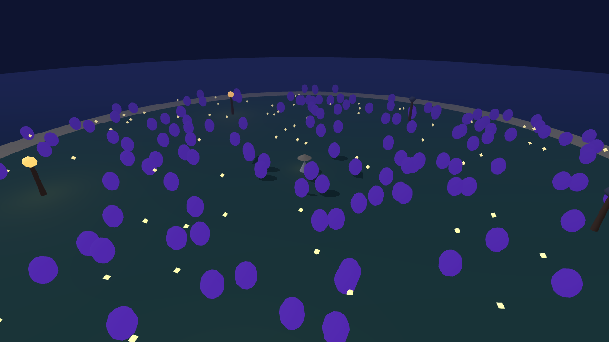

# Đảo Đèn Lồng — Game 3D & Headless Engine (`v1.0.0` · Contract v1.3)

> **Video Demo (< 5 phút):** [Xem / Tải Video Demo (.mp4, < 5 phút)](https://github.com/Dobit25/K5-L3A-DAY12-TruongHoangTung-2A202603651-AI-SDLC-Dao-Den-Long/releases/download/v1.0.0/demo.mp4) · [Trang Release v1.0.0](https://github.com/Dobit25/K5-L3A-DAY12-TruongHoangTung-2A202603651-AI-SDLC-Dao-Den-Long/releases/tag/v1.0.0)
> **Lưu ý file `_review`:** File này được đặt tên `README_review.md` để giữ nguyên tuyệt đối 5 file đề bài gốc còn lại (`GUIDE.md`, `CHECKPOINTS.md`, `SUBMISSION.md`, `RULES.md`, `RUBRIC.md`); nội dung sản phẩm đã được chốt sang `README.md` theo Phương án A (kèm lưu trữ nguyên văn đề bài gốc ở phần cuối `README.md`).



## Giới thiệu
**Đảo Đèn Lồng** là game 3D góc nhìn thứ ba qua **3 Đêm (Đảo Bến · Đảo Cau · Đảo Chuông)**: người chơi điều khiển **Mây** (đội nón lá treo đèn lồng nhỏ) gom **Đom Đóm**, thắp và châm dầu giữ tối thiểu **60% Đèn Lồng Lớn** cháy sáng tới bình minh (`3/5`, `4/6`, `5/7`), đẩy lùi **Bóng Mực** (có cơ chế hút dầu `drain`) và **Gió Lạc**, tận dụng **Lướt (Dash)**, **Bục nhảy**, **Bùa Gió**, **Tỏa Sáng (Pulse)**, **Bảng xếp hạng cục bộ**, và bộ tính năng **Dễ tiếp cận (Accessibility)** đầy đủ.

- **Tác giả:** TruongHoangTung — MSSV: `2A202603651` — Lớp: `K5-L3A`
- **Giấy phép:** [MIT](LICENSE) | **Ghi nguồn:** [CREDITS.md](CREDITS.md) | **Lịch sử thay đổi:** [CHANGELOG.md](CHANGELOG.md)

---

## Yêu cầu hệ thống
- **Runtime:** Node.js `>= 18` (đã kiểm thử trên Windows 11, macOS và Linux qua GitHub Actions) + trình duyệt hỗ trợ WebGL2 (Chrome / Edge / Safari / Firefox).
- **Tùy chọn Docker:** Hỗ trợ đóng gói bằng [Dockerfile](Dockerfile) (`docker build -t dao-den-long . && docker run -p 4173:4173 dao-den-long`).

---

## Cài đặt & Chạy nhanh (tối đa 3 lệnh từ bản clone sạch)
```bash
npm ci
npm run build
npm start
```
Mở trình duyệt tại `http://localhost:4173`. *(Lệnh `npm start` chạy `node scripts/run-game.mjs`, phục vụ bản web tĩnh `dist/` kèm API bảng xếp hạng lưu trực tiếp xuống đĩa cục bộ `data/leaderboard.json`).*

---

## Điều khiển (mặc định — đổi phím tự do trong Cài đặt)
| Phím mặc định | Hành động |
|---|---|
| `W / A / S / D` | Di chuyển theo hướng camera (`6.0 m/s`, `7.2 m/s` khi có Bùa Gió) |
| `Space` | Nhảy (`7.0 m/s`, chỉ nhảy khi chạm đất) |
| `ShiftLeft` | Lướt / Dash (`14 m/s`, `0.2s`, giữ độ cao khi lướt trên không, hồi `1.5s`, `0s` khi có Bùa Gió) |
| `E` (hoặc `Enter`) | Tương tác đèn (`<= 2.0m`): thắp mới (`10`), thắp lại (`5`), hoặc châm dầu đèn sáng (`+10` dầu/đom đóm) |
| `Q` | Tỏa Sáng / Pulse (tốn `3` đom đóm, bán kính 3D `5m` từ chân `+0.8m`, choáng `120t`, đẩy `4m`, hồi `3s`) |
| `P` hoặc `Esc` | Tạm dừng / Mở cài đặt (âm lượng, độ nhạy chuột, chế độ mù màu, giảm chuyển động, chữ lớn `×1.25`, đổi phím) |
| Kéo chuột trái hoặc `← / →` | Xoay camera (`cam_yaw_deg`) |
| `M` | Bật / tắt âm thanh tổng hợp |

---

## Kiểm chứng, Headless, Benchmark, Soak & Bảng xếp hạng (Contract v1.3)

| Mục đích | Lệnh chạy |
|---|---|
| **Cổng kiểm chứng toàn diện (1 lệnh)** | `npm run verify` |
| **Chế độ Headless (`--night 1\|2\|3`)** | `node dist-cli/cli/headless.js --seed 2026 --night 3 --ticks 18000 --snapshot-every 600 --out out.jsonl` |
| **Benchmark 30s 1280×720** | `node scripts/bench.mjs --seed 42 --duration 30 --out bench.json` |
| **Soak test 10 Đêm liên tiếp** | `node --expose-gc dist-cli/cli/soak.js --seed 7 --nights 10 --out soak.json` |
| **Xuất Bảng xếp hạng cục bộ** | `node scripts/run-game.mjs --export-leaderboard out.json` |

- **Ghi chú VSync & Bộ nhớ bản Web (`bench.json`):** `scripts/bench.mjs` khởi chạy Chromium/Chrome/Edge ở cửa sổ `1280×720` không toàn màn hình với cờ `--disable-frame-rate-limit --disable-gpu-vsync` (`vsync_off: true`). `peak_mem_mb` lấy từ `performance.memory.usedJSHeapSize` khi trình duyệt hỗ trợ (hoặc `null` nếu trình duyệt ẩn thông số bộ nhớ).

---

## Sáng tạo của tôi
Toàn bộ phần sáng tạo nằm hoàn toàn trong lớp hiển thị `src/render/` — **tách biệt tuyệt đối khỏi `src/core/` và bị tắt hoàn toàn trong cảnh benchmark & chế độ headless**:
1. **Không khí Ba Hòn Đảo cổ tích & Trải nghiệm tiếp cận toàn diện:** Mây đội nón lá treo đèn lồng mini tỏa sáng dần theo `carried / capacity`; biển mây trôi, bầu trời sao, bến gỗ Đảo Bến, cầu tre Đảo Cau, tháp chuông + lá bay Đảo Chuông; thanh dầu 3D + nhấp nháy `1 Hz` khi đèn yếu; đèn tắt xẹp 20% + vết rách; chế độ mù màu (`#00B3FF` + `#FFFFFF ⚠`), phụ đề sự kiện + mũi tên chỉ hướng Bóng Mực mới sinh, giảm chuyển động và chữ lớn `×1.25`.
2. **Âm thanh tổng hợp thời gian thực (Web Audio API):** Nhạc nền gió đêm êm nhẹ và đầy đủ SFX cho mọi hành động/sự kiện (ngũ cung nhặt đom đóm, nhảy, lướt, Bùa Gió, nạp/thắp đèn, Pulse, bị đánh, Bóng Mực xuất hiện, Gió Lạc, gió mạnh, đếm ngược 10s cuối, thắng/thua — 0 file audio ngoài).
- **Bằng chứng không ảnh hưởng lõi & số đo:** `npm run verify` (`33/33` tests PASS + SHA-256 determinism cả 3 Đêm), [bench.json](bench.json) (tắt toàn bộ thực thể sáng tạo) và [soak.json](soak.json) (`0` crash, RSS `52.6 → 59.9 MB`).

---

## Tài liệu & Bằng chứng SDLC (4 Phase)
- Contract: [game.contract.json](game.contract.json) (`v1.3`)
- Harness AI: [AGENTS.md](AGENTS.md), [.agents/skills/verify-phase/SKILL.md](.agents/skills/verify-phase/SKILL.md), [.github/workflows/ci.yml](.github/workflows/ci.yml)
- Ghi chép & Retro: [docs/notes/assumptions.md](docs/notes/assumptions.md), [docs/notes/adr-001-lantern-fuel-and-dawn-survival.md](docs/notes/adr-001-lantern-fuel-and-dawn-survival.md), [docs/notes/ai-log.md](docs/notes/ai-log.md), [docs/notes/retro.md](docs/notes/retro.md)
- Bằng chứng từng phase: `docs/proof/phase-1/`, `docs/proof/phase-2/`, `docs/proof/phase-3/`, `docs/proof/phase-4/`, [bench.json](bench.json), [soak.json](soak.json)
